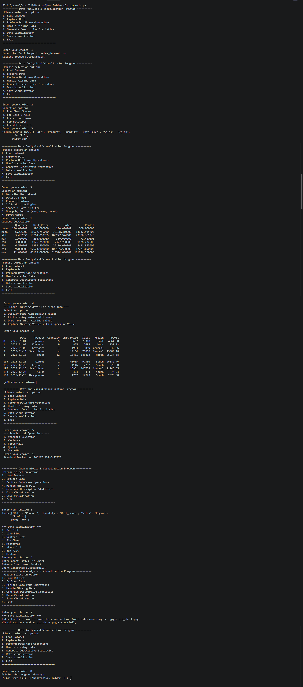
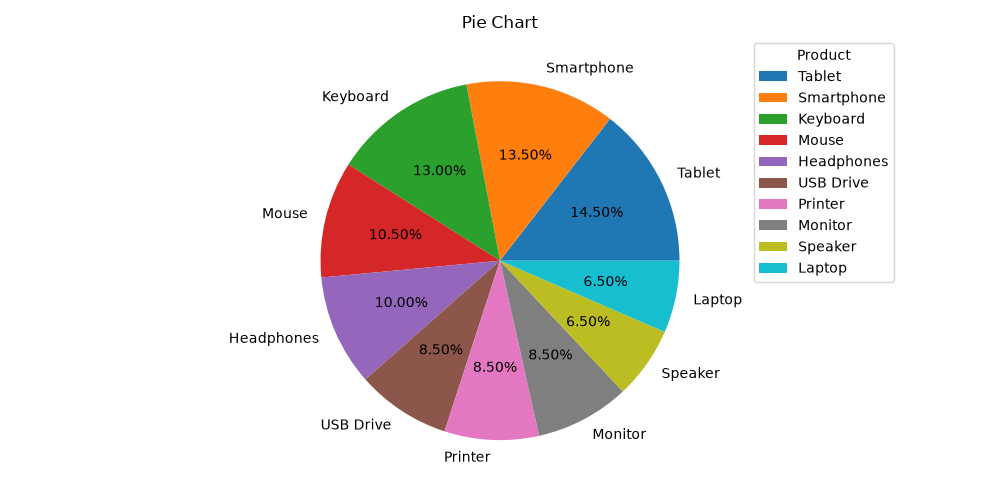

# 📊 Pandas Analyzer & Data Visualization

> A menu-driven Python tool for analyzing and visualizing sales data from CSV files.

---

## 📝 Project Description

**Pandas Analyzer & Data Visualization** is a command-line application that helps you understand sales data quickly. You load a CSV file and then use a simple numbered menu to explore the data, clean missing values, run statistical calculations, create charts, and save those charts as images.

It is built with an object-oriented design (a single `SalesdataAnalayzer` class) using Pandas, NumPy, Matplotlib, and Seaborn. It is useful for beginners learning data analytics and for anyone who wants a fast way to inspect a sales dataset without writing code each time. 🎯

---

## ✨ Features

- 📂 **Load Dataset**: load any CSV file by entering its path
- 🔍 **Explore Data**: view first 5 rows, last 5 rows, column names, datatypes, and dataset info
- 🛠️ **DataFrame Operations**:
  - describe the dataset and check its shape
  - rename columns
  - split or filter data by Region
  - search, sort (by Sales), and filter (Sales greater than a value)
  - group by Region (sum, mean, count)
  - create pivot tables
- 🧹 **Handle Missing Data**: display rows with missing values, fill with mean, drop rows, or replace with a custom value
- 📈 **Descriptive Statistics**: standard deviation, variance, 90th percentile, 75th quantile, describe
- 🎨 **Data Visualization**: bar, line, scatter, pie, histogram, stack plot, box plot, and correlation heatmap
- 💾 **Save Visualization**: export charts as `.png` or `.jpg`
- ✅ **Input checks**: friendly messages when no dataset is loaded or a wrong choice is entered

---

## 🧰 Technologies Used

| Technology | Purpose |
|------------|---------|
| 🐍 **Python 3** | Main programming language |
| 🐼 **Pandas** | Data loading, cleaning, and analysis |
| 🔢 **NumPy** | Numerical calculations (percentiles) |
| 📉 **Matplotlib** | Creating charts |
| 🌊 **Seaborn** | Box plots and heatmaps |
| 💻 **VS Code** | Code editor used for development |
| 🔧 **Git** | Version control |
| 🐙 **GitHub** | Hosting the project online |

---

## ⚙️ How to Run / Installation

### 1️⃣ Prerequisites
- Python 3.8 or higher installed ([download here](https://www.python.org/downloads/))
- Git installed ([download here](https://git-scm.com/downloads))

### 2️⃣ Clone the repository
```bash
git clone https://github.com/princy1806/pandas-analyzer-data-visualization.git
cd pandas-analyzer-data-visualization
```

### 3️⃣ Install required libraries
```bash
pip install pandas numpy matplotlib seaborn
```

### 4️⃣ Run the program
```bash
python main.py
```
*(Replace `main.py` with your script's file name.)*

### 5️⃣ Use the menu
Enter **1** first to load your CSV file, then choose any other option.

> 💡 **Dataset requirement:** your CSV should have the columns `Region`, `Sales`, and `Product` for all features to work.

Example:
```csv
Date,Region,Product,Sales
2025-01-01,North,Laptop,50000
2025-01-02,South,Phone,30000
```

## 📁 Project Structure

```
pandas-analyzer-data-visualization

├── main.py
├── sales_dataset.csv
├── pie_chart.png
├── output.png
├── README.md

```

---

## 🖼️ Output





---
## 👩‍💻 Author / Developer

**Pansuriya Princy**
